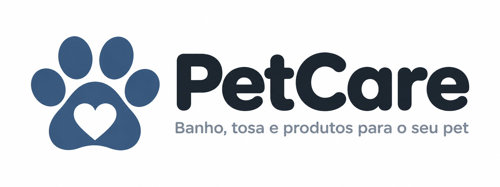

# PetCare - Front-end React Native



Aplicativo em React Native com Expo que consome a API de microservices do pet shop (projeto `microservices-java`). Todas as requisições passam pelo API Gateway.

## Integrantes

| Nome | RA | E-mail | Área |
| --- | --- | --- | --- |
| Carlos Eduardo Zanin | 1138275 | 1138275@atitus.edu.br | Front-end |
| Pedro Luis Alves Bartz | A informar | A informar | Front-end |
| Yuri Duarte Theisen | 1125371 | 1125371@atitus.edu.br | Front-end |
| Pedro Henrique Moreschi Rizzotto | 1138024 | 1138024@atitus.edu.br | Back-end |
| João Vitor da Silva | 1138170 | 1138170@atitus.edu.br | Back-end |
| Leonardo Grimm Maziero | 1137914 | 1137914@atitus.edu.br | Back-end |
| Rafael Scortegagna Pedra | A informar | A informar | Back-end |

O back-end está em [github.com/PedroRizzotto/microservices-java](https://github.com/PedroRizzotto/microservices-java).

## Funcionalidades

**Cliente**
- Login e cadastro (opção "Sou cliente" / "Sou pet shop")
- Início com pets, próximo agendamento e atalhos
- Loja com busca, filtro por categoria, paginação e conversão de moeda
- Detalhe do produto e carrinho (troca de loja quando o item é de outro pet shop)
- Checkout com escolha de endereço, pagamento simulado e confirmação
- Meus pedidos (detalhe, pagar e cancelar)
- Pet shops, serviços, horários livres e agendamento para um pet
- Meus agendamentos (detalhe, pagar e cancelar)
- Meus pets (cadastrar, editar e remover)
- Perfil: editar nome, alterar senha, endereços, histórico de pagamentos e moeda de exibição

**Pet shop (prestador)**
- Painel com indicadores e agenda do dia
- Dados do pet shop e horários de atendimento
- Catálogo: produtos (criar, editar, desativar) e serviços (criar, editar, remover)
- Pedidos recebidos com filtro por status (marcar enviado e entregue)
- Agendamentos recebidos (concluir e cancelar)

## Organização do projeto

```
src/
  config/       URL da API e tamanho de página
  theme/        cores, espaçamentos e tema do React Native Paper
  constants/    status, espécies, métodos de pagamento, moedas e dias da semana
  utils/        formatadores, validadores e diálogos
  storage/      persistência local (sessão e moeda) com AsyncStorage
  services/     comunicação com a API (um módulo por domínio)
    prestador/  rotas exclusivas do pet shop
  contexts/     AuthContext (sessão) e MoedaContext (moeda de exibição)
  hooks/        useRequisicao, useListaPaginada, useFormulario e useAcao
  components/   componentes reutilizáveis, separados por domínio
    comuns/     Tela, Botao, CampoTexto, Cartao, ListaPaginada...
  pages/        telas, separadas por módulo (auth, cliente, loja, agenda, pets, perfil, prestador)
  routes/       navegação (autenticação, cliente e prestador)
```

As telas não usam o axios direto, elas chamam os services, e os erros da API viram uma mensagem para mostrar na tela. O token vai junto em toda rota `/ws/`, e se a API devolver 401 o app volta para o login. Depois do login, o `user.type` decide se abre a área do cliente ou a do pet shop.

## Bibliotecas

- Expo, React Native
- React Navigation (native stack e bottom tabs)
- React Native Paper (componentes visuais)
- @expo/vector-icons (ícones)
- axios (HTTP)
- AsyncStorage (sessão salva no aparelho)

## Como rodar

1. Suba o backend. Na pasta `docker` do projeto `microservices-java`, crie o `.env` a partir do `.env.example` e rode:

```bash
docker compose up --build -d
```

2. Instale as dependências:

```bash
npm install
```

3. Configure a URL do gateway, trocando `192.168.0.10` pelo IP da sua máquina. O celular precisa estar na mesma rede:

```bash
EXPO_PUBLIC_API_URL=http://192.168.0.10:8080 npx expo start
```

No PowerShell:

```powershell
$env:EXPO_PUBLIC_API_URL="http://192.168.0.10:8080"; npx expo start
```

4. Leia o QR Code com o Expo Go.

## Usuário de teste

- Pet shop: `provider@provider.dev` / senha `teste`
- Cliente: crie pela tela de cadastro
